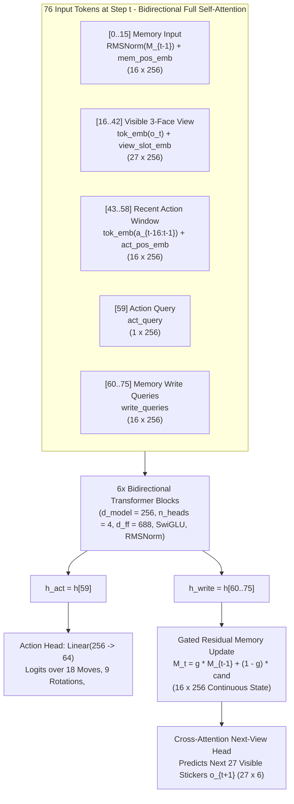

# Solving the Rubik's Cube Under Strict 3-Face Partial Observability via Recurrent Attention Feedback

[](#quick-start)
[](#architecture-recurrentcubelm)
[-orange)](#key-benchmark-results-256-episodes--task-3-face-view-only)
[](https://huggingface.co/spaces/sumitk/rubik-cube-3face-sim)
[](https://huggingface.co/sumitk/rubik-cube-3face-recurrent-ai)

- 🧊 **Live Interactive 3D & 2D Simulator (Hugging Face Space):** **[https://huggingface.co/spaces/sumitk/rubik-cube-3face-sim](https://huggingface.co/spaces/sumitk/rubik-cube-3face-sim)**
- 🤗 **Trained Checkpoints & Model Repository (Hugging Face Hub):** **[https://huggingface.co/sumitk/rubik-cube-3face-recurrent-ai](https://huggingface.co/sumitk/rubik-cube-3face-recurrent-ai)**
- 📄 **Full Technical White Paper:** **[`WHITEPAPER.md`](WHITEPAPER.md)**

An attention-based neural network trained from scratch to solve a $3\times 3\times 3$ Rubik's cube in closed loop under **strict 3-face partial observability**:
- **3-Face Partial View (`U, F, R` = 27 stickers):** At every step $t$, the agent only sees the 27 stickers of the Top (`U`), Front (`F`), and Right (`R`) faces. The Back (`B`), Left (`L`), and Down (`D`) faces are completely occluded.
- **View Replacement (POMDP):** Each step's 27-sticker view replaces the previous view. Whole-cube rotations (`x, y, z`) bring occluded faces into view while pushing previously visible faces out of view.
- **Recurrent Continuous Attention Feedback (`RecurrentCubeLM`, 5.35M params):** Maintains 16 gated continuous memory vectors across time, paired with a cross-attention next-view world-model head (`predict_next_view`).
- **Zero Search & Zero Kociemba at Inference:** The neural network outputs raw face turns (`U, R, F, D, L, B`), whole-cube rotations (`x, y, z`), and `<done>` in a greedy closed loop with zero external search or state scaffolding.

---

## Key Benchmark Results (256 Episodes / Task, 3-Face View Only)

| Task | Feed-Forward SFT (`sft_ufr3`, 14.2M) | Feed-Forward + GRPO RL (`rl_scratch`) | Recurrent No-BPTT (`rnn_nobptt`, $W=1$) | Recurrent $W=16$ (`rnn_mem`) | **Recurrent v3 (`rnn_v3/final.pt`, 5.35M)** | **Ablation: Memory Wiped (`--reset_mem`)** |
|---|---|---|---|---|---|---|
| `pll` (Last-Layer Permutation) | 60.2% | — | 93.4% | 91.8% | **100.0%** | 0.8% |
| `oll` (Last-Layer Orientation) | 44.5% | — | 57.8% | 59.4% | **100.0%** | 5.5% |
| `oll_pll` (Full Last Layer to `<done>`) | 20.7% | — | 53.1% | 53.5% | **100.0%** | **0.0%** |
| `f2l_pair` (Single F2L Pair) | 11.7% | — | 13.3% | 15.6% | **95.3%** | **0.0%** |
| `f2l` (All 4 F2L Pairs Chained) | 0.0% | — | 0.0% | 0.0% | **97.7%** | **0.0%** |
| `f2l_oll_pll` (4 F2L Pairs + OLL + PLL) | 0.0% | — | 0.0% | 0.0% | **97.3%** | **0.0%** |
| **`full` (Full 25-Move Scramble to `<done>`)** | **0.0%** | **0.0%** | **0.0%** | **0.0%** | **76.6%** | **0.0%** |
| `rev` Depth 1 / 2 / 3 / 4 | 100 / 100 / 97.7 / 72.3% | 100 / 100 / 98.4 / 75.4% | — / — / — / 46.1% | — / — / 92.6 / 67.2% | **100 / 100 / 99.6 / 83.2%** | — / — / — / 5.9% |

---

## Architecture (`RecurrentCubeLM`)



---

## Quick Start

### 1. Install Dependencies & Run Verification Suite
```powershell
python -m venv .venv
.\.venv\Scripts\pip install -r requirements.txt
.\.venv\Scripts\python.exe -m pytest -q
```

### 2. Launch the Interactive 3D & 2D Web Simulator
Visualizes the 3-face partial view (`U/F/R`) alongside the 6-face ground truth, with smooth 3D whole-cube rotation (`x, y, z`) and face-twist animations, live 16-slot memory heatmap, mental next-view prediction, and memory-wiping ablation toggle:
```powershell
.\.venv\Scripts\python.exe web_sim.py --port 8765
# Open http://127.0.0.1:8765 in your browser
```

### 3. Evaluate Checkpoints in Closed Loop
```powershell
# Standard closed-loop evaluation
.\.venv\Scripts\python.exe eval.py --ckpt runs/rnn_v3/final.pt --n 256

# Causal memory-wiping ablation (--reset_mem)
.\.venv\Scripts\python.exe eval.py --ckpt runs/rnn_v3/final.pt --n 256 --reset_mem
```

### 4. Generate Trajectories & Train from Scratch
```powershell
# 1. Generate active-slot CFOP trajectories (builds PDB caches automatically on first run)
.\.venv\Scripts\python.exe -m rubik.data.gen --out data_rnn3 --stage all --n 60000 --workers 8 --p_scratch 0.0 --p_rot 0.0 --inspect x_z2 --stage_glance --f2l_rotate --canonical_start

# 2. Pretrain 3-face next-view world model on random move+rotation walks
.\.venv\Scripts\python.exe pretrain_wm.py --out runs/wm_pretrain --iters 1500 --batch 256 --seq_len 24 --lr 5e-4

# 3. Train Recurrent v3 solver with W=64 full BPTT + next-view loss + online DAgger
.\.venv\Scripts\python.exe train_rnn_v2.py --data data_rnn3 --out runs/rnn_v3 --init runs/wm_pretrain/wm_final.pt --bptt 64 --batch 192 --lr 4e-4 --vp_weight 0.25 --short_iters 400 --all_iters 1600 --dagger_every 4 --dagger_batch 64 --f2l_rotate --canonical_start
```

See [`WHITEPAPER.md`](WHITEPAPER.md) for the complete mathematical formulation, all six experimental iterations, root-cause analyses of negative results, and full command-line reference.
