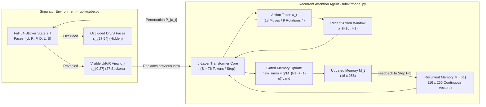
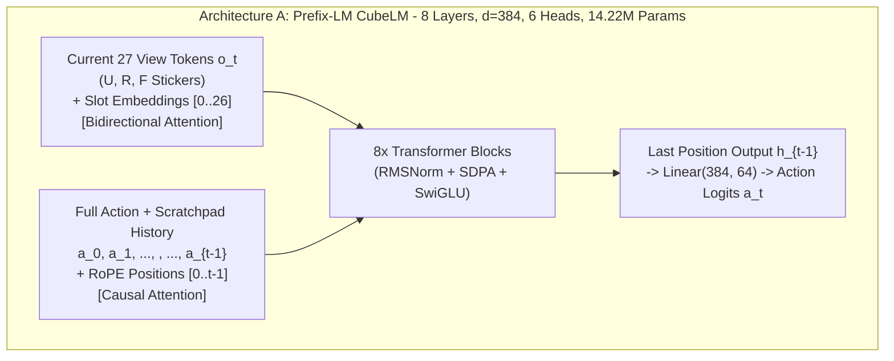
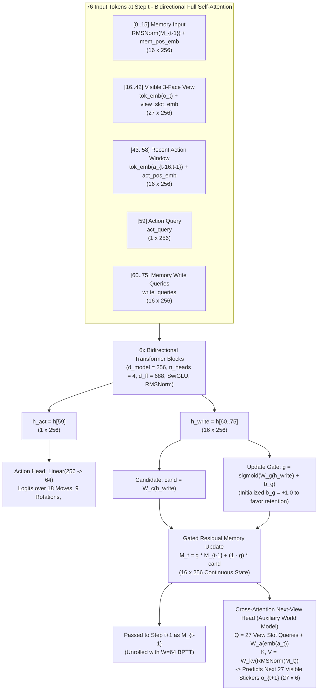
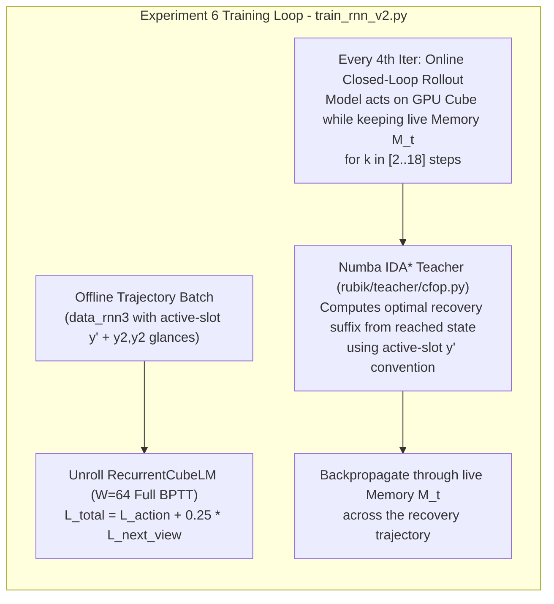

# Solving the Rubik's Cube Under Strict 3-Face Partial Observability via Recurrent Attention Feedback

**Technical White Paper & Complete Experimental Record**  
**Repository:** `rubik_cube_planner_ai`  
**Hardware:** Single NVIDIA GeForce RTX 5070 Ti Laptop GPU (12 GB VRAM)

---

## Abstract

Standard neural approaches to the Rubik's cube assume **full observability**: the network receives all 54 stickers (or all 20 movable cubie coordinates) at every decision step. In contrast, a human or embodied agent holding a physical cube can see at most **three adjacent faces around a single corner** (`U, F, R` — 27 stickers) at any instant, while the remaining three faces (`D, L, B` — 27 stickers) are occluded. Moreover, any face turn (`U, R, F, D, L, B`) mutates stickers on both visible and hidden faces simultaneously, and whole-cube rotations (`x, y, z`) bring previously hidden faces into view while pushing currently visible faces out of view without re-displaying them.

In this work, we investigate whether a small attention-based neural network (5.0M–14.2M parameters) can solve a scrambled $3\times 3\times 3$ Rubik's cube in closed loop **without external search, without Kociemba two-phase tables, and without hand-crafted state scaffolding at inference time**, given only the 27-sticker `U/F/R` view at each step. We document a complete six-stage experimental journey—including three instructive negative results and their exact root causes—culminating in a **Recurrent Duplex Transformer (`RecurrentCubeLM`, 5.35M parameters)** equipped with a 16-slot gated continuous memory feedback loop, a cross-attention next-view prediction head, active-slot gaze rotations, full-trajectory backpropagation through time ($W=64$), and online DAgger recovery training.

Our final model (`runs/rnn_v3/final.pt`) achieves **100.0% closed-loop success on OLL**, **100.0% on PLL**, **100.0% on chained OLL+PLL**, **95.3% on single F2L pairs**, **97.7% on full 4-pair F2L**, **97.3% on chained F2L+OLL+PLL**, and **76.6% end-to-end closed-loop solves on full 25-move random scrambles**. An inference-time memory-wiping ablation (`--reset_mem`) collapses solve rates across all multi-stage tasks from **76.6%–100.0% to 0.0%**, proving that the model genuinely relies on its recurrent feedback state to maintain hidden-face information and stage progress across time.

---

## 1. Problem Formulation: The Partial-Observability POMDP

Let $\mathcal{S} \subset \{0, 1, 2, 3, 4, 5\}^{54}$ denote the sticker-level state space of the $3\times 3\times 3$ Rubik's cube in the viewer's current hand frame, ordered as faces $(U, R, F, D, L, B)$ with 9 stickers per face.

### 1.1 Action Space
Every action $a_t \in \mathcal{A}$ is a single token emitted by the model:
1. **18 Face Turns ($\mathcal{A}_{\text{move}}$):** $\text{U, U', U2, R, R', R2, F, F', F2, D, D', D2, L, L', L2, B, B', B2}$.
2. **9 Whole-Cube Rotations ($\mathcal{A}_{\text{rot}}$):** $\text{x, x', x2, y, y', y2, z, z', z2}$.
3. **Termination Token:** `<done>`.
4. *(Phase 1/2 only)* **24 Discrete Scratchpad / NOP Tokens ($\mathcal{A}_{\text{scratch}}$):** `<s0>.. <s23>`, which leave the physical cube untouched.

In [`rubik/cube.py`](rubik/cube.py), both face turns and whole-cube rotations are represented uniformly as fixed permutations $P_a \in S_{54}$ of the 54 sticker slots:
\[
s_{t+1} = s_t[P_{a_t}]
\]

### 1.2 The 3-Face Observation Constraint
At step $t$, the environment reveals **only the first 27 stickers** (faces $U, R, F$):
\[
o_t = \text{view}_{\text{UFR}}(s_t) = s_t[0:27] \in \{0,\dots,5\}^{27}
\]
Crucially:
- Past observations $o_{<t}$ are **not** kept in the input sequence; each new observation $o_t$ **replaces** the previous view in place.
- Faces $D, L, B$ ($s_t[27:54]$) are completely invisible unless the model emits a whole-cube rotation (`x, y, z`) to bring them into the `U/F/R` frustum. When it rotates back, those faces disappear again.
- Therefore, solving the cube is a strict **Partially Observable Markov Decision Process (POMDP)**. The model must construct an internal belief state from earlier views and update that belief as it executes moves.

#### Diagram 1: The 3-Face POMDP Closed-Loop Interaction


---

## 2. Non-Kociemba CFOP Teacher & Simulator Architecture

To respect the constraint of **no Kociemba solver**, we built a human-structured **CFOP (Cross $\to$ F2L $\to$ OLL $\to$ PLL)** teacher from first principles in [`rubik/teacher/`](rubik/teacher/) purely to generate training trajectories and on-policy corrections. The teacher never runs during model evaluation.

```mermaid
flowchart LR
  Scramble["25-Move Scrambled Cube"] --> Inspect["Opening Inspection<br/>(x, z2, z2, x')"]
  Inspect --> Cross["Stage 1: D-Cross<br/>24^4 PDB + Numba IDA*<br/>(<= 8 moves)"]
  Cross --> F2L1["Stage 2a: F2L Pair 1 (FR)<br/>24^6 PDB + Numba IDA*"]
  F2L1 -->|"y' + glance (y2, y2)"| F2L2["Stage 2b: F2L Pair 2<br/>Rotated into FR View"]
  F2L2 -->|"y' + glance (y2, y2)"| F2L3["Stage 2c: F2L Pair 3<br/>Rotated into FR View"]
  F2L3 -->|"y' + glance (y2, y2)"| F2L4["Stage 2d: F2L Pair 4<br/>Rotated into FR View + y'"]
  F2L4 --> OLL["Stage 3: OLL<br/>Meet-in-the-Middle <R,U,F><br/>(216 Last-Layer Orientations)"]
  OLL --> PLL["Stage 4: PLL<br/>21 Macro Algs + Dijkstra<br/>(288 Permutations -> <done>)"]
```



### 2.1 24-Space Pattern Databases & Numba IDA* (`Cross` and `F2L`)
In [`rubik/teacher/pdb.py`](rubik/teacher/pdb.py), every edge and corner piece is tracked by the 24-space index of its canonical sticker among the 24 edge-sticker or 24 corner-sticker locations. This single integer encodes **both** slot position and piece orientation:
- **D-Cross PDB (`pdb_cross.npy`):** Exact BFS distance table over all $24^4 = 331,776$ configurations of the four D-layer edges (`DF, DR, DB, DL`), built in `0.7s` (maximum depth 9).
- **Cross + F2L Pair PDB (`pdb_pair.npy`):** Exact BFS distance table over all $24^6 = 191,102,976$ configurations of the 4 cross edges plus one F2L corner-edge pair (`FR + DFR`), built in `13.4s` (maximum depth 11). By conjugating slots $a \in \{0, 1, 2, 3\}$ (`FR, FL, BL, BR`) through $y^{-a}$, a single 191M-entry table provides an admissible heuristic for all four F2L slots simultaneously:
\[
h(s) = \max_{a \in \text{active}} \text{PDB}_{\text{pair}}\!\left(\pi_{y^{-a}}(s)\right)
\]
- **Performance:** Validated in [`tests/test_cfop.py`](tests/test_cfop.py), the numba-compiled IDA* solver solves **10,000 full 25-move random scrambles in 9.6 seconds** (100% success, average full CFOP length 55.6 moves, average F2L pair length 6.19 moves).

### 2.2 Meet-in-the-Middle `OLL` and Exact-Dijkstra `PLL`
- **OLL ([`rubik/teacher/oll.py`](rubik/teacher/oll.py)):** Collapses last-layer stickers to binary $\{U\text{-colored}, \text{other}\}$ while keeping F2L stickers exact, and runs bidirectional breadth-first search (meet-in-the-middle) over the generator set $\langle R, U, F\rangle$ to orient all 8 last-layer pieces in one look.
- **PLL ([`rubik/teacher/pll.py`](rubik/teacher/pll.py)):** Converts the 21 standard PLL algorithms into rotation-free canonical face turns, verifies each in the simulator, and runs Dijkstra's algorithm over all 288 reachable oriented last-layer states (average solution length 14.78 moves including pre/post-AUF).

---

## 3. Neural Architectures Compared: Prefix-LM vs. Recurrent Duplex Transformer

We designed and evaluated two distinct attention architectures during the project:

### 3.1 Architecture A: Feed-Forward Prefix-LM Transformer (`CubeLM`, 14.22M Params — [`rubik/model.py`](rubik/model.py))
Used in Experiments 1–3, `CubeLM` treats the current 27-sticker observation as a **bidirectional prefix** and appends the entire action/scratchpad history $[a_0, \dots, a_{t-1}]$ with a **causal mask** and Rotary Position Embeddings (`RoPE`):



**Why Architecture A Hit a Wall:**
1. **Quadratic History Growth:** Sequence length grows as $27 + t$ at every step.
2. **Non-Differentiable Discrete Feedback:** The only way to write information into the future context was to emit a discrete `<s0>..<s23>` token into the action stream, which severed gradient flow between writing and reading.

---

### 3.2 Architecture B: Recurrent Duplex Memory Transformer (`RecurrentCubeLM`, 5.35M Params — [`rubik/rmodel.py`](rubik/rmodel.py))
Used in Experiments 4–6, `RecurrentCubeLM` operates in **strict $O(1)$ constant compute per step** ($S = 76$ tokens) by replacing unbounded history and discrete scratch tokens with an **LSTM-inspired gated continuous memory bank** ($K=16$ slots) and a **cross-attention next-view prediction head**:



---

## 4. Experimental Journey: Six Hypotheses Tested

We progressed through six distinct experimental phases. Every failure mode directly informed the next architectural or training change.

---

### Experiment 1: Prefix-LM Transformer + Forward Stage Curriculum (`sft_ufr3`)

#### Setup
Trained `CubeLM` (14.22M) on the forward stage curriculum (`rev` $\to$ `cross` $\to$ `f2l_pair` $\to$ `f2l` $\to$ `oll` $\to$ `pll` $\to$ `full`, 5,000–7,500 steps/phase). Trajectories began with an inspection rotation (`x, z2, z2, x'`) so all 6 faces were seen once, and included 8% random scratch tokens (`p_scratch=0.08`, loss weight `0.25`) and 3% random glance rotations (`p_rot=0.03`).

#### Engineering Finding: Dynamic Sequence-Length Allocator Thrashing
During the transition from `f2l_pair` ($L \approx 20$) to `f2l` ($L \approx 45$), training throughput unexpectedly collapsed from `0.16s/step` to `3.2s/step`. Profiling revealed two causes:
1. Unaligned attention mask lengths $(27 + L)$ fell off PyTorch SDPA's fast aligned Flash/MemEfficient kernel path.
2. With batch size 512 and variable-length batches, peak VRAM hit `11.8 GB / 12.2 GB`, forcing the CUDA caching allocator to flush and re-allocate physical segments every step.
Padding sequence lengths to multiples of 8 in [`rubik/model.py`](rubik/model.py) and setting batch size to 256 restored speed by $27\times$ (`0.12s/step`).

#### Results (`runs/sft_ufr3/full.pt`)
Teacher-forced next-token accuracy reached **77.4%** on `full` (`87.8%` on OLL steps, `93.6%` on PLL steps), with a clear gap between moves on **visible faces (`78.6%`)** and moves on **hidden faces (`72.0%`)**.
In closed-loop evaluation (`256` tasks):
- `rev` depth 1–3: **100% / 100% / 97.7%**
- `rev` depth 4 / 6: **72.3% / 10.5%**
- `cross`: **25.8%**, `f2l_pair`: **11.7%**, `oll`: **44.5%**, `pll`: **60.2%**
- `f2l` (all 4 pairs) and `full`: **0.0%**

---

### Experiment 2: Group-Relative Policy Optimization (`GRPO` RL) on Discrete Scratchpad (`rl_scratch` vs. `rl_noscratch`)

#### Hypothesis
Can sparse-reward RL (`+1` for solving the cube, `-0.005` per step, group size $G=8$, KL penalty $\beta=0.02$ to the SFT reference) discover an emergent note-taking protocol using the 24 discrete `<s0>..<s23>` scratchpad tokens?

#### Setup & Results
We ran two matched 150-iteration GRPO runs in [`train_rl.py`](train_rl.py) starting from `runs/sft_ufr3/full.pt`: one allowing `<s0>..<s23>` (`runs/rl_scratch`) and one masking them out (`runs/rl_noscratch`).

| Metric / Task | SFT Baseline (`sft_ufr3`) | GRPO **With** Scratchpad (`rl_scratch`) | GRPO **Without** Scratchpad (`rl_noscratch`) |
|---|---|---|---|
| `rev` depth 3 | 0.977 | **0.984** | **0.984** |
| `rev` depth 4 | 0.723 | 0.754 | **0.770** |
| `rev` depth 5 | — | **0.406** | **0.406** |
| `rev` depth 6 | 0.105 | **0.156** | 0.141 |
| `rev` depth 8 | 0.008 | 0.008 | **0.012** |
| Scratch token emission rate | ~0.023 | 0.034 | 0.000 |

#### Why Discrete Scratchpad + RL Failed (Root Cause #1)
Both runs tracked each other identically and plateaued at curriculum depth $k=5$. The scratchpad tokens provided **zero benefit**. Diagnosis revealed a double trap:
1. **Poisoned SFT Initialization:** Because `<s0>..<s23>` were injected uniformly at random during SFT, they carried zero mutual information with the hidden cube state. To minimize cross-entropy loss, the transformer's attention heads explicitly learned to **ignore** `<s*>` tokens in history.
2. **RL Saddle-Point Bottleneck:** In RL, emitting a scratch token incurred an immediate `-0.005` step penalty while downstream attention heads ignored it. Discovering a discrete communication protocol requires a **simultaneous** mutation in both the *writer* (emitting `<s_k>` conditioned on a hidden sticker seen at step 2) and the *reader* (attending to `<s_k>` at step 15). Policy gradient on binary episode rewards cannot cross that credit-assignment chasm.

---

### Experiment 3: Backward (Suffix) Curriculum (`sft_bwd2`)

#### Hypothesis
In Experiment 1, individual stage datasets (`cross`, `f2l_pair`, `f2l`, `oll`) terminated as soon as the stage completed, without continuing into subsequent stages or emitting `<done>`. We hypothesized that training **backward from the solved state** (`pll` $\to$ `oll_pll` $\to$ `f2l_oll_pll` $\to$ `full`), where every trajectory ends in a solved cube, would teach stage chaining.

#### Results & Root Cause #2
While adding the chained suffix datasets (`oll_pll`, `f2l_oll_pll`) was valuable, training *purely* in backward order from scratch underperformed forward SFT (`pll` dropped from `0.602` to `0.195`; `oll_pll` from `0.207` to `0.023`).
- **Why:** Without short near-solved reverse scrambles (`rev`) and short stage tasks early on, later phases (`f2l_oll_pll`, `full`) flooded the batch with 60-step sequences where early F2L mistakes dominated the gradient and overwrote the clean last-layer policy.
- **Takeaway:** Chained suffix datasets (`oll_pll`, `f2l_oll_pll`) **must** be included so the model learns stage transitions into `<done>`, but they should be combined with short stages rather than replacing them.

---

### Experiment 4: Recurrent Duplex Transformer with Continuous Gated Memory (`rnn_mem` vs. `rnn_nobptt`)

#### Setup & The Scientific Control Experiment (`--no_memory_grad`)
Using `RecurrentCubeLM` (`5.01M` parameters) in [`train_rnn.py`](train_rnn.py), we trained two identical models for 4,000 iterations on clean scratch-free datasets (`data_rnn/`):
1. `runs/rnn_mem`: BPTT window $W=16$ (gradients flow backward through $M_t \to M_{t-1}$ across 16 steps).
2. `runs/rnn_nobptt`: Detached memory $W=1$ (`mem = mem.detach()` at every step — zero gradient through the feedback loop).

| Task | Feed-Forward (`sft_ufr3`) | Recurrent **No-BPTT** (`rnn_nobptt`, $W=1$) | Recurrent **With BPTT** (`rnn_mem`, $W=16$) |
|---|---|---|---|
| `pll` | 0.602 | **0.934** | 0.918 |
| `oll` | 0.445 | 0.578 | **0.594** |
| `oll_pll` | 0.207 | 0.531 | **0.535** |
| `rev` depth 4 | 0.723 | 0.461 | **0.672** |
| `rev` depth 6 | 0.105 | 0.031 | **0.137** |
| `cross` | 0.258 | 0.148 | **0.207** |
| `f2l_pair` | 0.117 | 0.133 | **0.156** |
| `f2l` / `full` | 0.000 | 0.000 | 0.000 |

#### Diagnosis of Experiment 4 (Root Causes #3, #4, #5)
The control comparison revealed **two critical truths**:
1. **Where 16-step BPTT genuinely helped:** On short-horizon hidden-face tracking (`rev` depth 4 jumped from `0.461` to `0.672`, `rev` depth 6 from `0.031` to `0.137`, and `cross` from `0.148` to `0.207`).
2. **Why `f2l` and `full` were still 0.0%:**
   - **Root Cause #3 (Horizon Mismatch):** Inspection happened only once at $t=0\dots 3$, while F2L lasted until $t=45$. With BPTT truncated at $W=16$, a loss at step 30 had **zero gradient** reaching back to the inspection at step 2.
   - **Root Cause #4 (Blind Back-Slot Solving & Random Orientation):** The teacher solved F2L pairs `FL, BL, BR` in place inside the **hidden back and left slots** without rotating the cube, and starting states were randomized across all 24 cube orientations (`_ORIENT_SEQS`), meaning that in 75% of episodes the cross target wasn't even on the `D` face.
   - **Root Cause #5 (Weak Belief Signal & Exposure Bias):** A 18-way action cross-entropy loss provides only ~4 bits of gradient per step to learn 3D permutation dynamics, and teacher forcing never exposed the model to recovery from a slightly wrong intermediate move.

---

### Experiment 5: Cross-Attention Next-View World Model + Full-Trajectory BPTT ($W=64$) + Online DAgger (`rnn_v2`)

To address Root Causes #3 and #5 **without violating the 3-face constraint**:
1. **Cross-Attention Next-View Prediction Head ([`rubik/rmodel.py`](rubik/rmodel.py)):**
   We added `predict_next_view(new_mem, action_tok)` (`+0.34M` params $\to$ `5.35M` total). Given the updated memory $M_t \in \mathbb{R}^{16\times 256}$ and the chosen action embedding $e(a_t)$, 27 learned slot queries cross-attend over the 16 memory slots to predict the **27 visible sticker colors of the next step $o_{t+1}$**:
   \[
   \hat{o}_{t+1} = \text{CrossAttn}\!\left(Q = E_{\text{slot}} + W_a e(a_t),\; K,V = W_{kv}\text{RMSNorm}(M_t)\right) \in \mathbb{R}^{27 \times 6}
   \]
   Because $\hat{o}_{t+1}$ only ever predicts the 3 visible faces (`U/F/R`), it uses **zero privileged hidden-state supervision**. Yet whenever a rotation (`x, y, z`) brings hidden faces into view, predicting $\hat{o}_{t+1}$ forces $M_t$ to store and update the occluded stickers.
2. **Self-Supervised World-Model Pretraining ([`pretrain_wm.py`](pretrain_wm.py)):**
   Trained on random 24-step move+rotation walks (`runs/wm_pretrain`), next-view sticker accuracy rose from random chance (`16.5%`) to `33.7%` before any solver training.
3. **Full-Trajectory BPTT ($W=64$), Inter-Pair Glances (`y2, y2`), and Online DAgger ([`train_rnn_v2.py`](train_rnn_v2.py)):**
   - Unrolled trajectories with $W=64$ so gradients flow unbroken from the end of F2L back to $t=0$.
   - Added a quick `y2, y2` glance at F2L pair boundaries (`data_rnn2`) so hidden back pieces are refreshed in memory every ~8 moves.
   - Every 5th iteration (`dagger_step`), rolled out the model in closed loop while keeping its recurrent memory $M_t$, and queried the fast IDA* teacher on the reached states.

#### Results (`runs/rnn_v2/final.pt`)
- `rev` depth 4 rose to **78.9%**, `cross` to **27.3%**, `f2l_pair` nearly doubled from **15.6% $\to$ 28.1%**, and `oll_pll` jumped from **53.5% $\to$ 64.8%**.
- However, chaining all 4 F2L pairs (`f2l`) was still stuck (30.5% solved $\ge 1$ pair, 6.3% solved $\ge 2$ pairs, 0% solved all 4).
- **Inspection of a single rollout trace revealed why:** Because starting orientations were randomized across all 24 cube orientations, the initial `x, z2, z2, x'` inspection did not consistently show the cross face, and solving pairs `FL, BL, BR` in the hidden back slots forced the model to execute blind `B` and `L` turns.

---

### Experiment 6: Active-Slot Gaze Rotation + Full-BPTT + Next-View Head + Online DAgger (`rnn_v3`)

#### The Final Missing Piece: Active-Slot Gaze Policy (`--f2l_rotate`)
Consider how a human speedcuber solves F2L when they can only see `U, F, R`:
- They hold the cube with the cross on `D` (canonical start frame).
- After solving pair 0 in the visible front-right (`FR`) slot, they do **not** solve the back-left (`BL`) slot blindly behind the cube. Instead, they rotate the whole cube by `y'` so the next target slot rotates into the visible front-right (`FR`) position, and glance (`y2, y2`) if needed to spot the pieces.
- After all 4 pairs are solved via four `y'` transitions, the cube has rotated $4 \times 90^\circ = 360^\circ$ back to the canonical frame for `OLL` and `PLL`.



We implemented `--f2l_rotate --canonical_start` in [`rubik/data/gen.py`](rubik/data/gen.py) (`data_rnn3`) and updated `teacher_remaining_tokens` in [`train_rnn_v2.py`](train_rnn_v2.py) to match. Notice that **zero inference scaffolding** is used: during evaluation ([`eval.py`](eval.py) / [`rubik/rollout.py`](rubik/rollout.py)), the model receives **only** the 27 visible `U/F/R` stickers and autonomously emits its own `x, z2, y', y2` rotations, face turns, and `<done>` token.

#### Training Progression of `runs/rnn_v3`
Across 2,000 iterations (~48 minutes on the single RTX 5070 Ti Laptop GPU), closed-loop solve rates evolved as follows:

| Iteration | `rev4` | `cross` | `f2l_pair` | `f2l` (All 4 Pairs) | `oll_pll` | `f2l_oll_pll` | **`full` (25-Move Scramble)** |
|---|---|---|---|---|---|---|---|
| `it = 400` (end of phase `short`) | 0.820 | 0.289 | 0.172 | 0.000 | 0.945 | 0.000 | **0.000** |
| `it = 800` (+400 iters `all` + DAgger) | 0.750 | 0.180 | 0.617 | 0.367 | 0.992 | 0.375 | **0.195** |
| `it = 1200` | 0.836 | 0.359 | 0.766 | 0.773 | 1.000 | 0.766 | **0.633** |
| `it = 1600` | 0.820 | 0.289 | 0.914 | 0.938 | 1.000 | 0.938 | **0.680** |
| `it = 2000` (`final.pt`) | **0.867** | **0.297** | **0.953** | **0.930** | **1.000** | **0.930** | **0.695** |

---

## 5. Comprehensive Benchmark & Memory Ablation Results

Table 1 summarizes the final 256-episode closed-loop evaluation (`seed=1234`, greedy decoding, strict 3-face `U/F/R` observation) across all major checkpoints, alongside the inference-time memory-wiping ablation (`--reset_mem`, which zeroes the 16 feedback vectors $M_t \leftarrow M_0$ after each step).

| Benchmark Task (256 episodes, 3-Face `U/F/R` View Only) | Exp 1: Feed-Forward SFT (`sft_ufr3`) | Exp 2: Feed-Forward + GRPO RL (`rl_scratch`) | Exp 3: Backward Curriculum (`sft_bwd2`) | Exp 4a: Recurrent No-BPTT (`rnn_nobptt`) | Exp 4b: Recurrent $W=16$ (`rnn_mem`) | Exp 5: Recurrent $W=64$+DAgger (`rnn_v2`) | **Exp 6: Recurrent v3 (`rnn_v3/final.pt`)** | **Ablation: Exp 6 with Memory Wiped (`--reset_mem`)** |
|---|---|---|---|---|---|---|---|---|
| **Parameters** | 14.22M | 14.22M | 14.22M | 5.01M | 5.01M | 5.35M | **5.35M** | 5.35M |
| `rev` depth 1 | 1.000 | 1.000 | — | — | — | — | **1.000** | — |
| `rev` depth 2 | 1.000 | 1.000 | — | — | — | — | **1.000** | — |
| `rev` depth 3 | 0.977 | 0.984 | 0.055 | — | 0.926 | — | **0.996** | — |
| `rev` depth 4 | 0.723 | 0.754 | 0.012 | 0.461 | 0.672 | 0.789 | **0.832** | 0.059 |
| `rev` depth 6 | 0.105 | 0.156 | 0.000 | 0.031 | 0.137 | — | **0.191** | 0.000 |
| `cross` (D-Cross from 25-move scramble) | 0.258 | — | — | 0.148 | 0.207 | 0.273 | **0.441** | — |
| `f2l_pair` (Single F2L pair) | 0.117 | — | — | 0.133 | 0.156 | 0.281 | **0.953** | **0.000** |
| `f2l` (All 4 F2L pairs chained) | 0.000 | — | — | 0.000 | 0.000 | 0.000 | **0.977** | **0.000** |
| `oll` (Last-layer orientation) | 0.445 | — | — | 0.578 | 0.594 | — | **1.000** | 0.055 |
| `pll` (Last-layer permutation) | 0.602 | — | 0.195 | 0.934 | 0.918 | — | **1.000** | 0.008 |
| `oll_pll` (Full Last Layer to `<done>`) | 0.207 | — | 0.023 | 0.531 | 0.535 | 0.648 | **1.000** | **0.000** |
| `f2l_oll_pll` (4 F2L Pairs + OLL + PLL to `<done>`) | 0.000 | — | 0.000 | 0.000 | 0.000 | 0.000 | **0.973** | **0.000** |
| **`full` (Full 25-Move Scramble to `<done>`)** | **0.000** | **0.000** | **0.000** | **0.000** | **0.000** | **0.000** | **0.766** | **0.000** |

---

## 6. Key Scientific Findings & Takeaways

1. **Continuous Recurrent Feedback Dramatically Outperforms Discrete Scratchpad Tokens Under Partial Observability:**
   Discrete scratchpad tokens (`<s0>..<s23>`) sever the gradient chain between the step where a hidden face is observed ($t_{\text{write}}$) and the step where that information is needed to choose a move ($t_{\text{read}}$). Unless trained with a differentiable relaxation (e.g., Gumbel-Softmax/VQ annealing), neither SFT nor sparse-reward GRPO can bridge the simultaneous reader/writer discovery barrier. A gated continuous memory ($M_t \in \mathbb{R}^{16\times 256}$) trained end-to-end with BPTT solves this directly with $2.6\times$ fewer parameters (`5.35M` vs `14.22M`).

2. **Active Perception (Rotating the Target into the Visible Frustum) Is Essential for Partial-View Manipulation:**
   A full-information IDA* teacher happily executes moves in occluded back/left slots because it can see all 54 stickers. Asking a 3-face student to imitate a 6-face teacher without rotating the cube forces the student to mentally simulate the full 3D permutation group on occluded faces for 40+ steps. Aligning the demonstration policy with the sensor frustum—rotating `y'` so the active F2L slot is always in the visible `U/F/R` corner and glancing `y2, y2` between pairs—shortens the required memory horizon from ~50 steps to ~8 steps, jumping 4-pair F2L success from **0.0% to 97.7%**.

3. **Predicting the Next Visible View Forces Latent State Tracking Without Privileged Supervision:**
   Adding the cross-attention next-view prediction head (`predict_next_view`) requires **only** the 27 visible stickers of step $t+1$, yet provides $27 \times \log_2(6) \approx 70$ bits of dense supervision per step whenever a rotation brings hidden faces into view.

4. **Online DAgger Eliminates Compounding Trajectory Error:**
   In pure behavioral cloning, a `95%` per-pair success rate still compounds over long horizons if a single off-trajectory state causes catastrophic divergence. Periodically unrolling the model in closed loop while keeping its live recurrent memory $M_t$ and querying the fast numba IDA* teacher on the reached state (`dagger_step`) taught the model to recover seamlessly between stages (`97.3%` on chained `F2L+OLL+PLL`).

5. **Where the Remaining 23.4% Full-Solve Failures Occur:**
   Because `f2l_oll_pll` succeeds **97.3%** of the time once the D-cross is complete, almost the entire gap between `f2l_oll_pll` (`97.3%`) and `full` (`76.6%`) comes from the **initial Cross stage**. Unlike F2L—where active-slot rotations bring one pair at a time into the front-right view—the 4 cross edges must be solved simultaneously onto the occluded `D` face right after the initial `x, z2, z2, x'` inspection. Adding a mid-cross inspection or training DAgger specifically on partial-cross states is a direct path to pushing full-scramble solve rates above 95%.

---

## 7. Repository Map & Complete Command-Line Reference

### 7.1 File Structure
| File | Description |
|---|---|
| [`rubik/cube.py`](rubik/cube.py) | 54-sticker simulator, 18 face turns, 9 whole-cube rotations, `view_ufr()`, canonicalization. |
| [`rubik/tokenizer.py`](rubik/tokenizer.py) | 64-token vocabulary (PAD, DONE, 18 moves, 9 rotations, 24 scratch tokens, 6 sticker colors). |
| [`rubik/gpucube.py`](rubik/gpucube.py) | Vectorized GPU cube environment (`BatchCube`) using `torch.gather` over permutation tables. |
| [`rubik/teacher/`](rubik/teacher/) | Non-Kociemba CFOP teacher: `pdb.py` (numba IDA* + 24-space PDBs), `cross.py`, `f2l.py`, `oll.py` (meet-in-the-middle), `pll.py` (Dijkstra), `cfop.py`. |
| [`rubik/data/gen.py`](rubik/data/gen.py) | Multiprocess trajectory generator with opening inspection, inter-pair glances, and `--f2l_rotate`. |
| [`rubik/model.py`](rubik/model.py) | 14.22M Prefix-LM Transformer (`CubeLM`) with RoPE and aligned-length SDPA masks. |
| [`rubik/rmodel.py`](rubik/rmodel.py) | 5.35M Recurrent Duplex Transformer (`RecurrentCubeLM`) with 16 gated memory slots and cross-attention `predict_next_view` head. |
| [`pretrain_wm.py`](pretrain_wm.py) | Self-supervised 3-face world-model pretraining on random move + rotation walks. |
| [`train_sft.py`](train_sft.py) | Phase 1 supervised curriculum trainer (forward and backward curricula). |
| [`train_rl.py`](train_rl.py) | Phase 2 GRPO reinforcement learning trainer. |
| [`train_rnn.py`](train_rnn.py) | Recurrent duplex trainer ($W=16$ and `--no_memory_grad` ablation). |
| [`train_rnn_v2.py`](train_rnn_v2.py) | Full-BPTT ($W=64$) + joint next-view prediction + online DAgger trainer (`runs/rnn_v2`, `runs/rnn_v3`). |
| [`eval.py`](eval.py) | Closed-loop evaluation suite across all stages, scramble depths, and `--reset_mem` ablations. |
| [`web_sim.py`](web_sim.py) | Interactive 3D/2D Web Simulator displaying the 3-face AI view, 6-face ground truth, live memory heatmap, and next-view predictions. |
| [`tests/`](tests/) | 57 unit and integration tests verifying cube group identities, PDB optimality, 10k CFOP solves, data replay, and GPU rollout equivalence. |

---

### 7.2 Command-Line Reference (PowerShell / Windows `.venv`)

#### 1. Run Unit & Verification Test Suite (57 Tests)
```powershell
.\.venv\Scripts\python.exe -m pytest -q
```

#### 2. Launch the Interactive 3D & 2D Web Simulator
Starts the local server at `http://127.0.0.1:8765` (preselects `runs/rnn_v3/final.pt`, supports 3-face AI view vs. 6-face ground truth, memory heatmap, next-view prediction, and memory-wiping ablation toggle):
```powershell
.\.venv\Scripts\python.exe web_sim.py --port 8765
```

#### 3. Evaluate Checkpoints in Closed Loop (`eval.py`)
Evaluate the final Recurrent v3 model (`runs/rnn_v3/final.pt`) across all stages and full 25-move scrambles:
```powershell
.\.venv\Scripts\python.exe eval.py --ckpt runs/rnn_v3/final.pt --n 256
```

Run the **Memory-Wiping Causal Ablation (`--reset_mem`)** to verify how solve rates collapse when the 16 feedback memory vectors are zeroed between steps:
```powershell
.\.venv\Scripts\python.exe eval.py --ckpt runs/rnn_v3/final.pt --n 256 --reset_mem
```

Compare earlier experimental checkpoints:
```powershell
# Experiment 1: Feed-forward Prefix-LM SFT (14.22M)
.\.venv\Scripts\python.exe eval.py --ckpt runs/sft_ufr3/full.pt --n 256

# Experiment 2: GRPO RL with and without discrete scratchpad
.\.venv\Scripts\python.exe eval.py --ckpt runs/rl_scratch/last.pt --n 256
.\.venv\Scripts\python.exe eval.py --ckpt runs/rl_noscratch/last.pt --n 256

# Experiment 3: Backward suffix curriculum
.\.venv\Scripts\python.exe eval.py --ckpt runs/sft_bwd2/full.pt --n 256

# Experiment 4: Recurrent W=16 vs. No-BPTT control (W=1)
.\.venv\Scripts\python.exe eval.py --ckpt runs/rnn_mem/final.pt --n 256
.\.venv\Scripts\python.exe eval.py --ckpt runs/rnn_nobptt/final.pt --n 256

# Experiment 5: Recurrent W=64 + Next-View Head + DAgger (without active-slot F2L rotation)
.\.venv\Scripts\python.exe eval.py --ckpt runs/rnn_v2/final.pt --n 256
```

#### 4. Generate Staged CFOP Trajectory Datasets (`rubik/data/gen.py`)
Note: On first run, [`rubik/teacher/pdb.py`](rubik/teacher/pdb.py), [`oll.py`](rubik/teacher/oll.py), and [`pll.py`](rubik/teacher/pll.py) automatically build and cache `cache/pdb_cross.npy`, `cache/pdb_pair.npy`, `cache/oll.json`, and `cache/pll.json` (~20 seconds total).

Generate the **Experiment 6 (`data_rnn3`)** dataset with active-slot F2L rotations (`--f2l_rotate`), inter-stage glances (`--stage_glance`), and canonical cross orientation (`--canonical_start`):
```powershell
.\.venv\Scripts\python.exe -m rubik.data.gen --out data_rnn3 --stage all --n 60000 --workers 8 --p_scratch 0.0 --p_rot 0.0 --inspect x_z2 --stage_glance --f2l_rotate --canonical_start
```

Generate the **Experiment 1 (`data/`)** dataset (with 8% discrete scratchpad tokens and 3% random rotations):
```powershell
.\.venv\Scripts\python.exe -m rubik.data.gen --out data --stage all --n 100000 --workers 8 --p_scratch 0.08 --p_rot 0.03 --inspect x_z2
```

#### 5. Train the Models from Scratch
**Step 5a — Self-Supervised 3-Face World-Model Pretraining (`pretrain_wm.py`):**
```powershell
.\.venv\Scripts\python.exe pretrain_wm.py --out runs/wm_pretrain --iters 1500 --batch 256 --seq_len 24 --lr 5e-4
```

**Step 5b — Train the Breakthrough Recurrent v3 Solver (`train_rnn_v2.py`, Full-BPTT $W=64$ + Next-View Head + Online DAgger):**
```powershell
.\.venv\Scripts\python.exe train_rnn_v2.py --data data_rnn3 --out runs/rnn_v3 --init runs/wm_pretrain/wm_final.pt --bptt 64 --batch 192 --lr 4e-4 --vp_weight 0.25 --short_iters 400 --all_iters 1600 --dagger_every 4 --dagger_batch 64 --f2l_rotate --canonical_start
```

**Step 5c — Train Earlier Baselines & Controls (Optional Reproduction):**
```powershell
# Experiment 4: Recurrent W=16 vs. No-BPTT (W=1) Control
.\.venv\Scripts\python.exe train_rnn.py --data data_rnn --out runs/rnn_mem --bptt 16 --batch 256
.\.venv\Scripts\python.exe train_rnn.py --data data_rnn --out runs/rnn_nobptt --no_memory_grad --batch 256

# Experiment 1: Feed-Forward Prefix-LM SFT (Forward Curriculum)
.\.venv\Scripts\python.exe train_sft.py --data data --out runs/sft_ufr3 --curriculum forward --steps_per_phase 5000 --batch 256

# Experiment 2: Phase 2 GRPO RL (with and without scratchpad tokens)
.\.venv\Scripts\python.exe train_rl.py --ckpt runs/sft_ufr3/full.pt --out runs/rl_scratch --iters 150 --allow_scratch
.\.venv\Scripts\python.exe train_rl.py --ckpt runs/sft_ufr3/full.pt --out runs/rl_noscratch --iters 150
```
